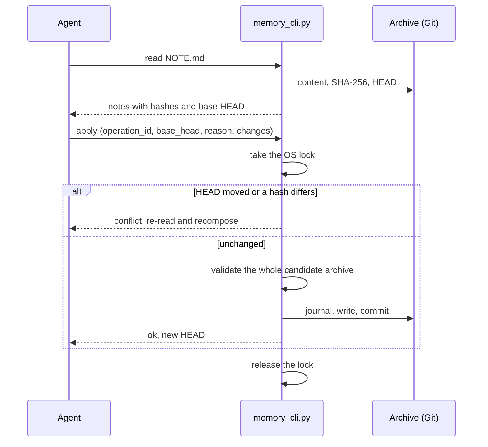

<p align="center">
  
</p>

<h1 align="center">Memory Tools</h1>

<p align="center">
  <b>A shared, persistent memory for coding agents, safe under concurrent writes.</b>
</p>

<p align="center">
  
  
  
  
  
</p>

Claude Code and Codex read and update the same folder of Markdown notes about
the user, their projects and their decisions, without a server or a database:
plain files in a Git repository, written through one command-line tool that
makes every update safe under concurrency.

> [!NOTE]
> The store runs on Windows (it relies on the native Windows file lock); WSL
> sessions use it through the Windows Python interpreter.

## Why

Agent memories are usually private to one tool and one machine. Here both
agents (and both Windows and WSL sessions) share one archive, so a decision
recorded by one agent is known to the other. The hard part is not storage but
concurrent writes: two sessions editing the same note at the same time must
not silently overwrite each other.

## How an update is saved



- **Read with hashes**: `read` returns the content of each note with its
  SHA-256 and the current Git `HEAD`.
- **Compare-and-swap batches**: `apply` takes a JSON request with exactly
  four fields: `operation_id` (a fresh UUID), the `base_head` that was read, a
  `reason` and `changes`, the full new content of every changed file with its
  expected hash. If `HEAD` moved or any listed file differs from what was read,
  the batch is rejected as a conflict and the agent re-reads and recomposes it.
- **Idempotent retries**: repeating the same `operation_id` after an uncertain
  outcome does not apply the batch twice.
- **Native OS lock** on the canonical physical path of the archive (aliases and
  reparse points are resolved or refused first). The kernel releases it when
  the process ends: no PID files, no timeouts that break a live lock.
- **Journal and preimages**: a failed write is rolled back from the
  preimages. If the process dies mid-write, the pending journal blocks every
  later operation until it is inspected, instead of guessing.
- **Validation and commit**: file names (lowercase `user_`, `project_`,
  `feedback_`, `person_`, `reference_` notes plus `MEMORY.md`, no subfolders),
  front matter, index size and links are checked, every note must be indexed
  in the same batch, and new lines may not contain typographic long dashes (a
  house style rule in `memory_store/validation.py`). Then only the files of
  the batch are committed, with the reason in the commit message.

## Hooks

`hooks_bridge.py` connects the store to the agents' hook systems:

- `SessionStart`: injects the memory index, the CLI commands and the path of
  the protocol into the session.
- `UserPromptSubmit`: a short reminder of the write procedure.
- `PreToolUse`: denies direct edits of the memory folder through the editing
  tools, so that every write goes through `apply`.
- `SessionEnd`: runs a consistency check (the commit already happened in
  `apply`).

On Windows with WSL, WSL sessions call the same Windows interpreter, so there
is a single runtime and a single lock.

## Commands

```powershell
python -X utf8 memory_cli.py index
python -X utf8 memory_cli.py read NOTE.md MEMORY.md
python -X utf8 memory_cli.py search "QUERY"
python -X utf8 memory_cli.py doctor                 # exit code 3 if not ok
python -X utf8 memory_cli.py apply --agent claude   # JSON request on stdin
python -X utf8 memory_cli.py apply --agent codex --request request.json
```

Global options go before the command: `--root PATH` (archive folder) and
`--lock-timeout SECONDS`. `--agent` accepts `claude`, `codex` and
`maintenance`.

## Setup

1. Python 3.13 (the version it is tested on), then `python -m venv .venv` and
   `.venv\Scripts\python.exe -m pip install -r requirements.txt`.
2. Create the archive folder as a Git repository (a real `.git` folder, not a
   worktree) with a `MEMORY.md` index and at least one commit; Git must be
   installed with an identity configured, and the working tree must be clean.
   The store creates a sibling folder `<archive>.shared-state` for the lock and
   the journal.
3. `config.toml` holds neutral defaults for the CLI (archive in
   `~/.claude/memory`). Put machine-specific values in `config.local.toml` (not
   versioned), which overrides `config.toml` key by key. The hooks do not read
   it: they pass `--root` explicitly, by default the `memory` folder next to
   this one.
4. Copy `PROTOCOL.example.md` to `PROTOCOL.md` and adapt it: it tells the
   agents when to read, when to write and how to tell facts from inferences.
5. Register `hooks_bridge.py --agent claude` (and `--agent codex`) for the hook
   events above in each agent's settings.

## License

MIT, see [LICENSE](LICENSE).
